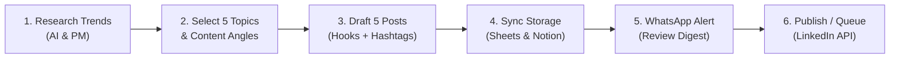

# 🚀 AI Social Media Content Agent for LinkedIn

An autonomous, multi-channel AI agent designed to plan, research, draft, repurpose, and schedule high-performing content for **LinkedIn**.

---

## 🌟 What It Can Do

- **🔍 Industry Topic & Trend Research**: Scrapes live RSS feeds (Google News, Hacker News, TechCrunch, ArXiv AI) and analyzes trending discussions, industry friction points, and controversial debates.
- **💡 5-Archetype Content Idea Generation**:
  1. *The Contrarian Take* (debunking popular SaaS/AI myths)
  2. *The Tactical Framework* (actionable 4-step execution guides)
  3. *The Real-World Case Study* (story-driven failure-to-win breakdown)
  4. *The Strategic / Executive Analysis* (unit economics, headcount, ROI)
  5. *The Curated Stack / Cheat Sheet* (bookmark-worthy toolsets)
- **✍️ Viral LinkedIn Post Drafter**:
  - Enforces the **above-the-fold hook** (optimized to stop the scroll before the `...see more` cutoff at ~140 characters).
  - Clean whitespace, single-sentence paragraphs, and unicode bullets (`→`, `•`, `✓`, `❌`).
  - Conversational closing question (CTA) designed to drive comment section algorithms.
- **🏷️ Smart Captions & Hashtag Engine**: Generates 3-5 curated, high-traffic industry hashtags and short captions.
- **🔄 Long Article Repurposer Studio**: Converts any blog post, newsletter, YouTube transcript, or URL into:
  - *Format A*: Standalone viral LinkedIn post.
  - *Format B*: 5-7 Slide PDF Document Carousel Outline with copy & designer visual cues.
  - *Format C*: 3-Day sequential mini-series.
- **📊 Multi-Channel Storage & Sync**:
  - Auto-updates local professional Excel content calendar (`data/linkedin_content_calendar.xlsx`).
  - Native Google Sheets API sync.
  - Native Notion Database sync.
- **📲 WhatsApp Review Dispatch**:
  - Sends a weekly review digest with hook previews.
  - Twilio WhatsApp Sandbox / Production integration.
  - **1-Click Direct `wa.me` links** for instant testing without API credentials!
  - Incoming webhook handler to approve posts via WhatsApp replies (e.g. `APPROVE 1` or `APPROVE ALL`).
- **🌐 1-Click & API LinkedIn Publisher**:
  - Direct LinkedIn REST API v2 (`/v2/ugcPosts`) support.
  - Instant 1-click LinkedIn Share Intent composer generator.
  - Interactive **Authentic LinkedIn Feed Simulator**.

---

## ⚡ The Monday Morning Workflow

Every Monday morning at **09:00 AM** (or triggered on demand), the automated pipeline executes:



1. **Research**: Gathers breaking AI and Product Management developments from Google News, Hacker News, and TechCrunch.
2. **Select Topics**: Formulates 5 distinct content angles with controversy scores and debate points.
3. **Generate Drafts**: Writes 5 full LinkedIn posts with scroll-stopping hooks and targeted hashtags.
4. **Save Drafts**: Appends entries to your Google Sheets / Excel Content Calendar and Notion Database.
5. **WhatsApp Review**: Dispatches a WhatsApp notification digest with direct review links.
6. **Publish Approved**: Posts approved drafts directly through LinkedIn API or generates 1-click share links.

---

## 🛠️ Quickstart

### 1. Requirements
- Python 3.10+
- Pip dependencies installed:

```bash
pip install -r requirements.txt
```

### 2. Configure Environment (`.env`)
Copy `.env.example` to `.env`:

```bash
cp .env.example .env
```

| Variable | Description |
|---|---|
| `GEMINI_API_KEY` | (Recommended) Google Gemini API Key. |
| `GROQ_API_KEY` | (Optional) Groq Cloud API Key for ultra-fast Llama-3.3. |
| `OPENAI_API_KEY` | (Optional) OpenAI API Key. |
| `DEFAULT_TOPIC` | Default research topic (default: `"AI and product management developments"`). |
| `WORKFLOW_SCHEDULE_DAY` | Day to run automation (e.g. `mon`). |
| `WORKFLOW_SCHEDULE_TIME` | Time to run automation (e.g. `09:00`). |
| `TWILIO_ACCOUNT_SID` | (Optional) Twilio Account SID for live WhatsApp dispatch. |
| `TWILIO_AUTH_TOKEN` | (Optional) Twilio Auth Token. |
| `RECIPIENT_WHATSAPP_NUMBER`| Your WhatsApp phone number (`whatsapp:+1234567890`). |
| `NOTION_API_KEY` | (Optional) Notion Integration token. |
| `NOTION_DATABASE_ID` | (Optional) Notion Database ID. |
| `GOOGLE_SERVICE_ACCOUNT_PATH`| (Optional) Path to Google service account credentials. |
| `GOOGLE_SHEETS_SPREADSHEET_ID`| (Optional) Google Spreadsheet ID. |
| `LINKEDIN_ACCESS_TOKEN` | (Optional) LinkedIn API OAuth Access Token. |

> **Note:** The agent includes a built-in smart heuristic fallback engine. You can run and test every single feature immediately even before adding external API keys!

---

## 🖥️ Running the Web Dashboard

Launch the interactive Command Center:

```bash
python main.py start-server
```
Then open: **[http://localhost:8000](http://localhost:8000)**

### Dashboard Features:
- **Feed Simulator Modal**: View your post in an authentic LinkedIn desktop/mobile card with character counts, avatar, and reaction buttons.
- **Workflow Stepper**: 1-click "Run Monday Workflow" with live progress indicators.
- **Topic Explorer**: Search any industry keyword live and convert trends into drafts with 1 click.
- **Repurposer Studio**: Paste article URLs or text to generate posts, PDF carousel outlines, and mini-series.
- **Calendar Downloader**: Download the auto-generated `LinkedIn_Content_Calendar.xlsx` at any time.

---

## ⌨️ CLI Commands

Run the full Monday morning workflow:
```bash
python main.py run-workflow
python main.py run-workflow --topic "Autonomous AI Agents in FinTech"
```

Research live trending discussions:
```bash
python main.py research --query "AI code editors Cursor and Copilot" --count 5
```

Repurpose an article or transcript:
```bash
python main.py repurpose --url "https://techcrunch.com/article"
python main.py repurpose --text "Your long article text..."
```

Inspect content queue:
```bash
python main.py posts
python main.py posts --status needs_review
```

Approve or publish a post:
```bash
python main.py approve 1
python main.py publish 1
```

Sync & download Excel Content Calendar:
```bash
python main.py export-sheets
```

Send WhatsApp Review digest:
```bash
python main.py send-whatsapp
```

---

## 📂 Project Structure

```
├── agent/
│   ├── config.py              # Central settings & env loader
│   ├── db.py                  # SQLite database repository & models
│   ├── llm.py                 # Multi-provider LLM (Gemini, Groq, OpenAI + Fallback)
│   ├── researcher.py          # RSS & Web trend researcher (Google News, HackerNews)
│   ├── ideator.py             # 5-angle viral content ideation engine
│   ├── drafter.py             # LinkedIn post drafter, hook optimizer & hashtags
│   ├── repurposer.py          # Article-to-post, carousel slides & mini-series
│   ├── workflow.py            # Complete 6-step Monday morning pipeline
│   ├── scheduler.py           # APScheduler weekly recurring runner
│   └── integrations/
│       ├── sheets.py          # Google Sheets API & formatted Excel export
│       ├── notion.py          # Notion Database sync
│       ├── whatsapp.py        # Twilio WhatsApp & 1-click wa.me links
│       └── linkedin.py        # LinkedIn REST API v2 & Share Intent generator
├── web/
│   ├── app.py                 # FastAPI web application & REST API
│   └── templates/
│       └── index.html         # Modern Tailwind + Alpine.js interactive dashboard
├── data/
│   ├── content_agent.db       # SQLite content & audit database
│   └── linkedin_content_calendar.xlsx # Styled Excel calendar workbook
├── main.py                    # Unified CLI & server runner
├── requirements.txt           # Project dependencies
└── README.md                  # Documentation
```

---

## 🔒 Security & Privacy
- Sensitive tokens and API credentials remain in `.env` and are never committed.
- Local SQLite database and Excel files are stored locally in `data/`.

